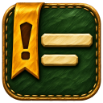
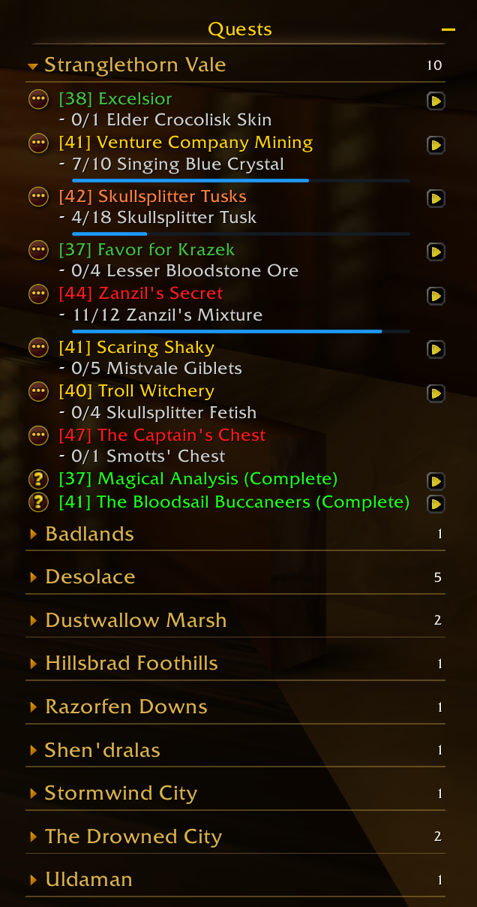
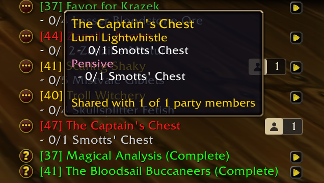
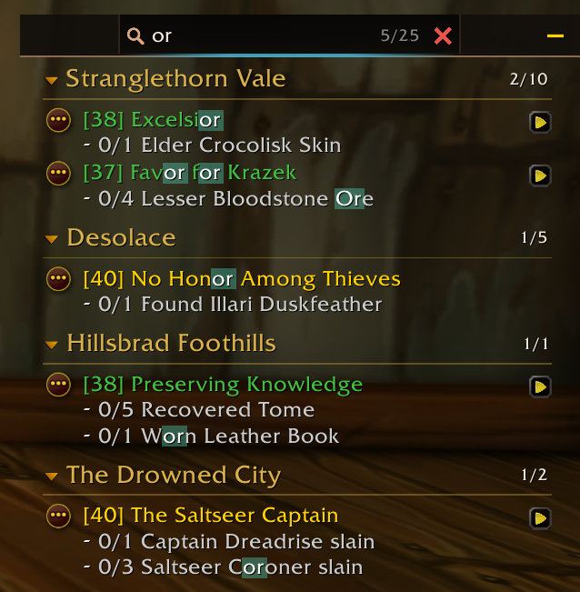
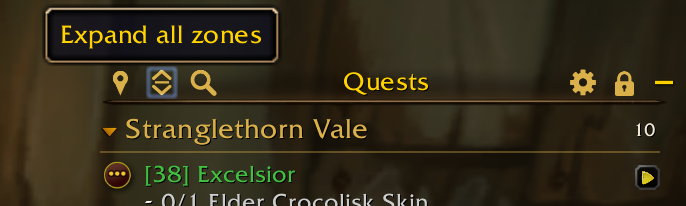
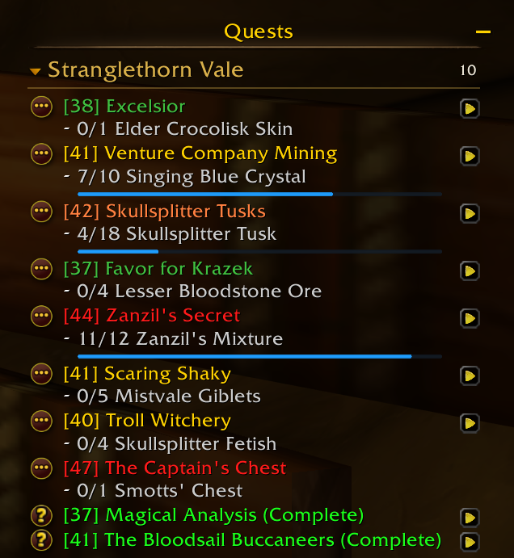
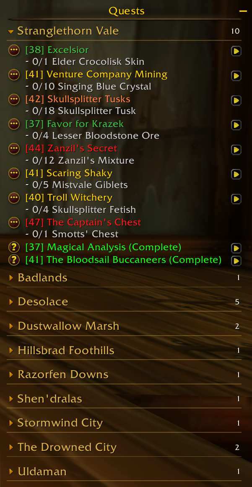
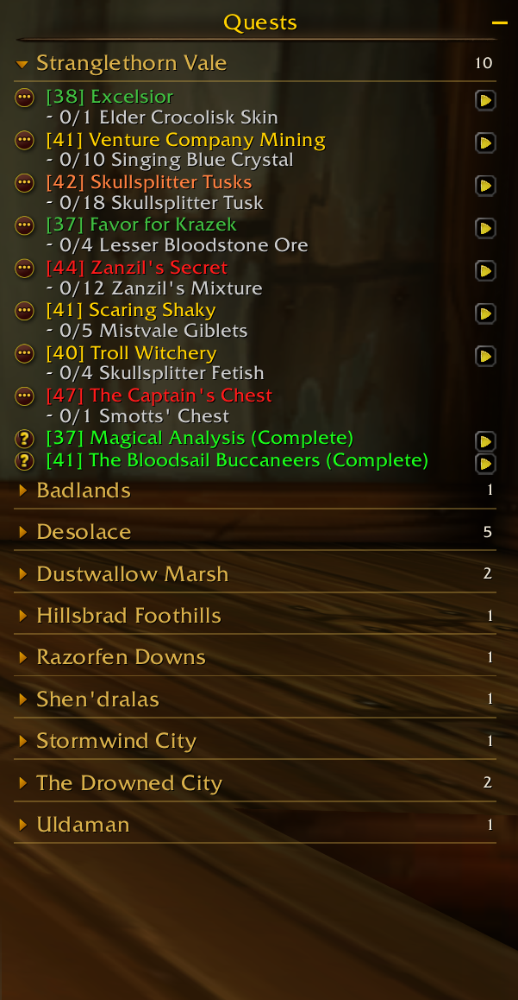
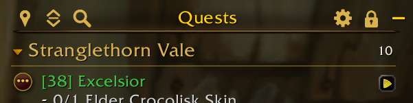
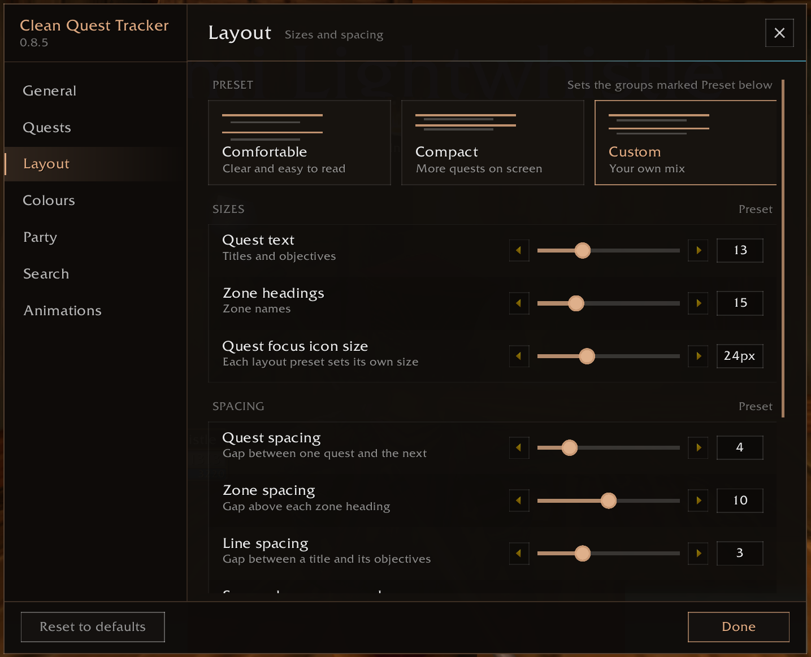

# Clean Quest Tracker

**See what is left in your zone, and who in your party is on the same quest, without opening the quest log.**

A quest tracker for World of Warcraft Forever.

**[Download](https://www.curseforge.com/wow/addons/cleanquesttracker)** &nbsp;·&nbsp; [Features](#features) &nbsp;·&nbsp; [Install](#install) &nbsp;·&nbsp; [Commands](#commands) &nbsp;·&nbsp; [Changelog](CHANGELOG.md) &nbsp;·&nbsp; [Report a bug](https://github.com/lumi-lightwhistle/clean-quest-tracker/issues/new?template=bug_report.yml)

 

<table align="center">
<tr>
<td valign="top"></td>
<td valign="top">  </td>
</tr>
<tr>
<td align="center">Quests by zone, current zone first</td>
<td align="center">Party progress, and search</td>
</tr>
</table>

## Features

<table>
<tr>
<td valign="middle" width="56%">

&nbsp; 
**Quests by zone**

Your current zone stays on top, even in caves and buildings, and the list re-sorts when you enter a new zone. Fold zones one at a time, pin focus to keep only your current zone open (zones that join the list later fold too), or expand everything in one click. 
&nbsp;

</td>
<td valign="middle" align="center"></td>
</tr>
<tr>
<td valign="middle">

&nbsp; 
**Search**

Hover the Quests bar, click the magnifying glass and type part of a quest title or objective. The list narrows as you type, the matching letters are marked, and folded zones with a match open by themselves. Enter keeps the filter; Esc while typing, or the X, clears it. 
&nbsp;

</td>
<td valign="middle" align="center"></td>
</tr>
<tr>
<td valign="middle">

&nbsp; 
**Party questing**

A badge shows how many group members also have each quest. Hover it to see who and how far along they are, even across the map with Questie. Click it to share the quest with anyone missing it. 
&nbsp;

</td>
<td valign="middle" align="center"></td>
</tr>
<tr>
<td valign="middle">

&nbsp; 
**Objective progress**

Bars fill as you collect items and defeat enemies. Finished quests turn green and fold to a single line, in the order you tracked them, at the top of their zone, or at the bottom. 
&nbsp;

</td>
<td valign="middle" align="center"></td>
</tr>
<tr>
<td valign="middle">

&nbsp; 
**Yours to arrange**

Comfortable or Compact spacing, your own colours, six party badge styles, an optional dark panel with padding and rounded corners, and a border. Two themes, Classic (bronze, corner flourishes, a crest) and Moonglow (silver, night sky, moonlit effects), or mix your own from every part. Try a theme before you keep it. Unlock the frame to move and resize it. Animation is Snappy, Smooth or off. 
&nbsp;

</td>
<td valign="middle" align="center"> </td>
</tr>
<tr>
<td valign="middle" colspan="2">

&nbsp; 
**Behaves like the original**

Quest item buttons, map pins and the right-click menu work as they do in Blizzard's tracker, and shift-click links a quest in chat even with the chat box closed. The add-on never modifies Blizzard's tracker code. 
&nbsp;

</td>
</tr>
</table>

## Install

- **CurseForge app:** search for *Clean Quest Tracker*, or open the [project page](https://www.curseforge.com/wow/addons/cleanquesttracker).
- **By hand:** download the zip from the [latest release](https://github.com/lumi-lightwhistle/clean-quest-tracker/releases/latest) and extract the `CleanQuestTracker` folder into `Interface/AddOns`. Restart the game fully the first time.

## Getting started

Hover the tracker's header and click the **cog**, or type `/cqt`, to open settings. Hover a setting to see the part of the list it changes, shaded in gold. Settings that don't apply right now are greyed out and say why.

Shift-click a quest to link it in chat. Right-click it for the quest menu, including Stop tracking.

 

## Commands

| Command | What it does |
|---|---|
| `/cqt` | Open settings |
| `/cqt unlock`, `/cqt lock` | Show or hide the move strip and resize grip |
| `/cqt compact`, `/cqt comfortable` | Switch layout preset |
| `/cqt party` | List what each source reports about your party's quests, if a count looks wrong |
| `/cqt reset` | Restore every setting to its default |
| `/cqt preview` | Show the progress bar effects side by side |

## Works with

- **Questie** gives party quest counts and progress at any distance through its party sync.
- **Spoken** adds its voiceover play buttons to your quests.
- If another add-on shows its own quest tracker, turn that one off so your quests don't appear twice. Clean Quest Tracker hides Blizzard's tracker for you; switch that off in settings if you want it back for scenarios or achievements.

## Contributing

Bug reports, ideas and pull requests are welcome. The [contributing guide](.github/CONTRIBUTING.md) covers setting up, testing in game and opening a pull request. Releases are automatic: merged changes collect in a release pull request, and merging it publishes to GitHub and CurseForge.

## License

[MIT](LICENSE). Formerly Simple Quest Tracker and, before that, Quest Companion.
